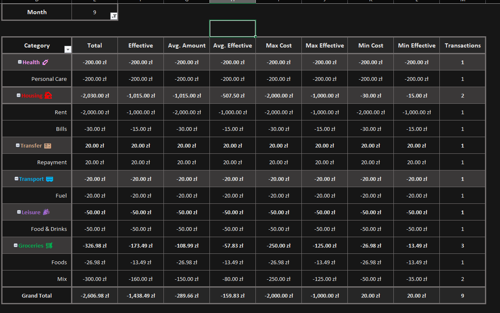
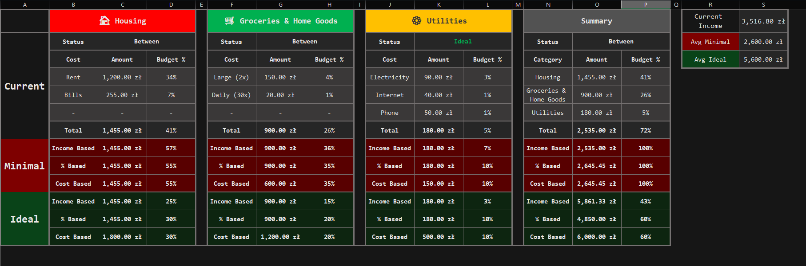
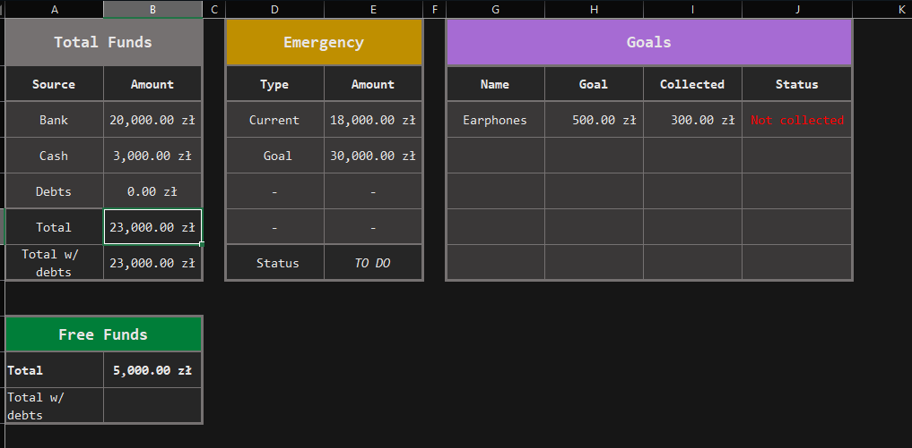
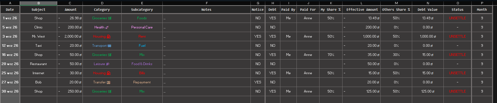
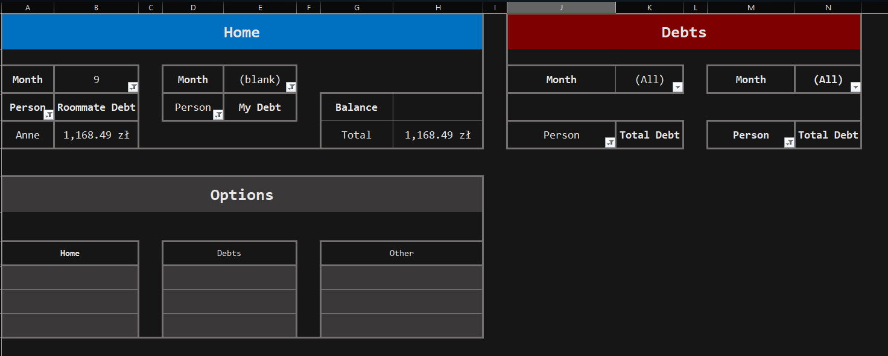

# Personal Finance Tracker

A Microsoft Excel-based personal finance management system designed to track income, expanses, shared transactions, debts, and savings.

The project was created to simplify everyday financial management, automate calculations, and provide a clear overview of personal finances.

One of its key features is **shared expense management**, allowing multiple people to split purchases using custom percentages and automatically calculate outstanding balances.

## Features

- **Income & Expense Tracking** - Record and categorize financial transactions
- **Monthly Financial Summary** - Analyze spending by categories and subcategories
- **Budget Planning** - Monitor recurring expenses and their share of the budget
- **Funds Management** - Track available funds, emergency savings, and financial goals
- **Shared Expenses** - Split transaction costs between people using customizable percentages
- **Debt Tracking** - Automatically calculate outstanding balances based on recorded transactions
- **Transaction Highlights** - Mark and review significant financial transactions
- **Data Validation** - Use predefined categories, subcategories, and counterparties to maintain consistent records
- **Automated Reporting** - Generate financial summaries using formulas and pivot tables

## Screenshots

### Monthly Summary

### Budget Baseline

### Funds Overview

### Transactions

### Debt Management

## Workbook Structure

The workbook consists of nine interconnected worksheets.

| Worksheet | Description |
|---|---|
| Summary | Monthly financial overview with detailed expense statistics. |
| Baseline | Recurring expenses, budget allocation, and spending distribution. |
| Funds | Available balances, emergency savings, financial goals, and free funds. |
| Transactions | Central database for income, expenses, and shared transactions. |
| Debts | Tracking of shared expenses and other outstanding debts. |
| Noticable | Overview of transactions marked as significant. |
| Subjects & Persons | Reference list of people, stores, and other counterparties. |
| Category | Categories and subcategories used for transaction classification. |
| Item % | Default cost-sharing percentages for frequently purchased items. |

## Summary

Provides a monthly overview of expenses, grouped by categories and subcategories.

Includes statistics such as:

- Total and effective spending
- Average and effective average spening
- Highest and lowest transaction amounts
- Highest and lowest effective transaction amounts
- Number of transactions

  *Effective spending represents the actual cost assigned to a person after shared expenses are calculated.*

  ## Baseline

  Organizes recurring expenses and helps estimate monthly financial requirements.

  The main expense groups include:

  - Housing
  - Groceries & Home Goods
  - Utilities
 
  Each group contains individual expenses and their percentage contribution to the overall budget.

  ## Funds

  Provides an overview of financial resources divided into several sections:

  - **Total** - Overall financial position
  - **Cash & Bank** - Funds available in cash and bank accounts
  - **Emergency** - Emergency savings, targeting six months of income
  - **Goals** - Savings allocated to specific financial objectives
  - **Free Funds** - Remaining funds available for flexible spending
 
  ## Transactions

  The central worksheet used to register and manage financial activity.

  Each transaction can include its date, counterparty, amount, category, subcategory, description, shared-expanse details, effective costs, and debt settlement status.

  Transactions can also be marked as significant for separate tracking.

  ## Debts

  Automatically summarizes outstanding balances based on recorded transactions.

  The worksheet separates:

  - **Shared Expenses** - Amounts owed between household members, including a net balance
  - **Other Debts** - Financial obligations involving other people
 
  ## Supporting Worksheets

- **Noticable** - Displays transactions marked as important
- **Subject & Persons** - Maintains a predefined list of counterparties
- **Category** - Defines available categories and subcategories
- **Item %** - Stores default expense-sharing percentages for selected purchases

## Shared Expense Management

The system supports flexible expense splitting, particularly useful for shared household expenses.

Instead of manually calculating reimbursements after every purchase, users can record transactions and assign individual cost percentages.

For example:

**Item**       :    **My %**
Bottled Water  :      70%

## Technical Implementation

The workbook uses built-in Microsoft Excel functionality, including:

- **Excel Tables** - Structured transaction records and reference data
- **Pivot Tables** - Dynamic financial summaries and debt reporting
- **Formulas** - Automatic calculations of effective expenses, percentages, and balances
- **Data Validation** - Controlled inputs based on predefined reference lists
- **Interconnected Worksheets** - Consistent data flow between transactions, summaries, and financial reports

## Getting Started

1. Download the Excel workbook from this repository
2. Open it in Microsoft Excel
3. Review the predefined categories, counterparties, and cost-sharing percentages.
4. Add transactions to the **Transactions** worksheet
5. Review financial summaries, available funds, and outstanding debts in the corresponding worksheets
6. Refresh pivot tables when necessary to update reports

## Project Status

**Functional Excel prototype - ongoing development**

The published version does not include VBA macros, which are currently being refines.

The workbook also serves as a foundation for a planned web-based personal finance application.

## Technologies

Microsoft Excel - Pivot tables - Excel Formulas - Data Validation - Financial Reporting

## Privacy

The publicly shared workbook is intended for demonstration purposes and should contain only fictional or anonymized financial data.
